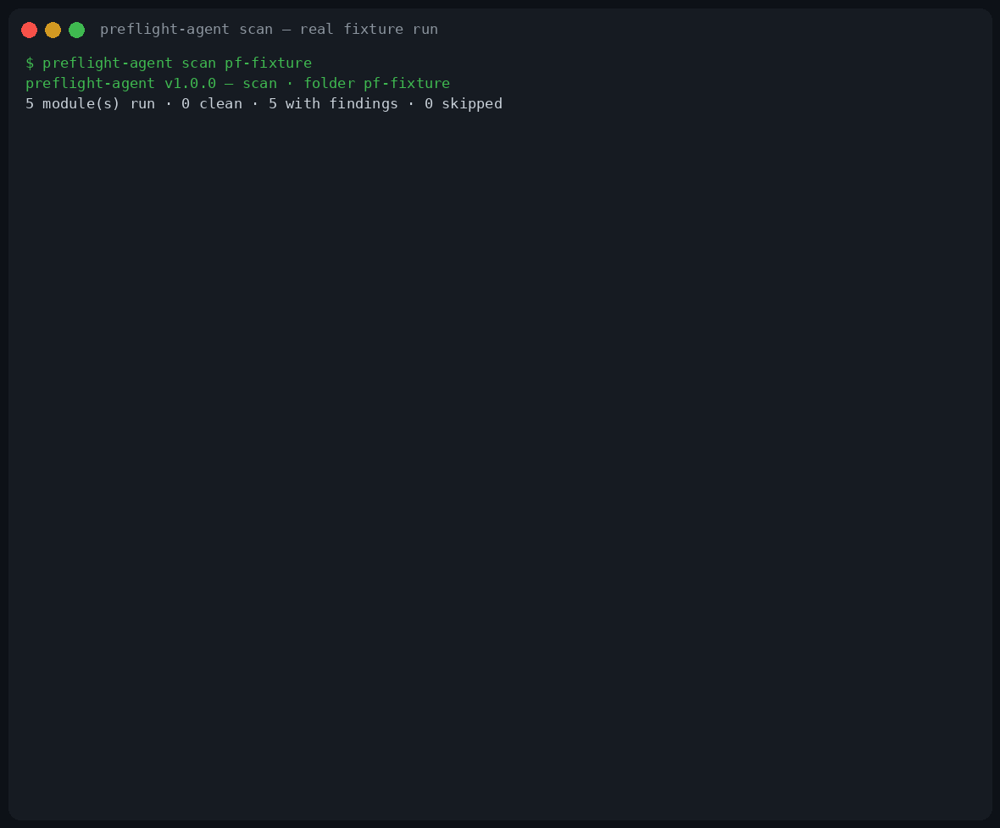

<h1 align="center">preflight-agent</h1>

<p align="center"><strong>Five checks your AI-agent setup needs before it runs — one command.</strong></p>

<p align="center">
  
  
  
  
  
</p>

<p align="center"></p>

Five things quietly go wrong in an AI-agent setup before
anyone notices: a folder that executes code the moment it
is opened, a live API key sitting in a config file, a
safety hook that was never going to fire, two agents a
router cannot tell apart, a skill collection too sprawled
to discover anything in. Each used to need its own tool —
five of mine, all published separately, all sitting quiet.
Now one command runs all five audits and prints a single
combined receipt:

```bash
preflight-agent scan ~/my-project
```

**Static and read-only — a scan executes nothing.** No
module runs, imports, or installs anything in the target;
the reports cite what they found instead of judging
intent. And the verdicts are honest about their edges: a
module with nothing to audit reports **skipped with its
reason**, never clean, and every module prints its own
limits in its own section of the receipt.

## The receipt family

preflight-agent is the *before it runs* member of a
family built on one grammar — *document = claims, code =
evidence, every verdict cited*:

- **preflight-agent — is this setup safe to open?**
  The five preflight checks below, in one receipt.
- **[skill-vet](https://github.com/jasveerai88/skill-vet)
  — is this skill pack dangerous?** Stealing, spying,
  hidden sending, each proven as a combination of
  evidence before you install.
- **[permission-audit](https://github.com/jasveerai88/permission-audit)
  — do these permissions grant more than intended?**
  Audits a Claude Code allowlist chain: wildcard grants,
  dangerous modes, rules that can never fire.
- **[done-claim-auditor](https://github.com/jasveerai88/done-claim-auditor)
  — did the agent do what it claimed?** Claim-vs-evidence
  logic pointed at session transcripts.
- **[skill-claims](https://github.com/jasveerai88/skill-claims)
  — does a skill do what it claims?** Audits a skill's
  prose promises against its static behaviour.
- **[spec-receipt](https://github.com/jasveerai88/spec-receipt)
  — does the code still match the spec?** Audits a repo's
  engineering spec against its declared implementation
  surfaces.

## Quick start

```bash
pipx install preflight-agent           # or: pip install preflight-agent
preflight-agent scan path/to/setup
```

*(The PyPI name goes live when v1.0.1 is published; until
then use the git form —
`pipx install git+https://github.com/jasveerai88/preflight-agent` —
or a source checkout: `python3 src/preflight_agent.py scan <dir>`.)*

One command, one receipt, an exit code you can gate on —
**1** = at least one module has findings, **0** = every
module that ran is clean, **2** = usage/input error. Add
`--json` for a machine-readable receipt. Python 3.10+,
standard library only, no dependencies, no network.

## The five modules

Every module is also runnable on its own, with exactly
the interface its standalone tool had:

| Command | What it catches | Its verdict words |
|---|---|---|
| `preflight-agent clone-guard DIR` | What executes when this folder is opened, installed, or committed to: Claude / VS Code / devcontainer configs, npm install scripts, direnv, git and husky hooks — every command shown verbatim | AUTO-RUN / INSTALL-TIME / PRESENT / UNPARSEABLE |
| `preflight-agent secret-guard scan FILE...` | Inline secrets in agent/MCP config files — findings by key path and fingerprint; values are never printed | INLINE-SECRET / ENV-LITERAL / UNPARSEABLE |
| `preflight-agent secret-guard fix FILE... [--apply]` | Rewrites those literals as `${ENV_VAR}` references. Dry run unless `--apply`; a timestamped backup is kept beside each changed file, and the rewrite is re-scanned before it is reported | — (the suite's one writing command; see the exception below) |
| `preflight-agent hook-doctor audit SETTINGS [--home DIR]` | Claude Code hooks that can never fire, can never block, or point at files that do not exist | ERROR / WARNING / INFO |
| `preflight-agent fleet-audit audit FOLDER` | In a folder of agent definitions: description collisions, duplicate names, tool grants that contradict the promised job, unreadable files | ERROR / WARNING / INFO |
| `preflight-agent skill-sprawl audit FOLDER` | In a tree of skills: cross-scope duplicate names, discovery collisions, oversized bodies, and a discovery-budget truncation forecast | ERROR / WARNING / INFO |

## The combined scan

```bash
preflight-agent scan DIR [--home DIR] [--json]
```

`scan` points each module at the part of DIR it audits:

- **clone-guard** — DIR itself.
- **secret-guard** — every discovered config file:
  `settings.json`, `settings.local.json`, `.mcp.json`,
  `mcp.json` anywhere under DIR, plus any JSON inside a
  `.claude`, `.vscode` or `.cursor` folder. Scan only —
  the combined scan **never** calls fix.
- **hook-doctor** — the first of `.claude/settings.json`,
  `settings.json`, `.claude/settings.local.json`.
  `--home` defaults to DIR itself, so a self-contained
  setup is audited as its own home.
- **fleet-audit** — `.claude/agents`, else `agents`, else
  DIR itself.
- **skill-sprawl** — `.claude/skills`, else `skills`,
  else DIR itself.

### The fixture — one planted problem per module

`examples/make_fixture.py` builds a fake setup with
exactly one planted problem per module — an `.envrc`
that runs on `cd`, a literal service key in `.mcp.json`,
a PreToolUse guard pointing at a script that does not
exist, the agent name `reviewer` defined twice, the
skill name `notes-writer` defined in two scopes — and
everything else deliberately clean. Verbatim output of
the real run (build it yourself and diff):

```
$ python3 examples/make_fixture.py pf-fixture
fixture built at pf-fixture
$ preflight-agent scan pf-fixture
preflight-agent v1.0.1 — scan · folder pf-fixture
5 module(s) run · 0 clean · 5 with findings · 0 skipped

===== clone-guard — what runs when this folder is opened =====
clone-guard v0.1.0 — scan · folder pf-fixture
pf-fixture · 3 finding(s) — 3 AUTO-RUN · 0 INSTALL-TIME · 0 PRESENT · 0 UNPARSEABLE

AUTO-RUN — executes on open, session start or cd, with no install step (3):
  .claude/settings.json — Claude Code PreToolUse hook — runs automatically when Claude Code works in this folder
    command: python3 "$HOME/.claude/hooks/guard-rm.sh"
  .claude/settings.json — Claude Code SessionStart hook — runs automatically when Claude Code works in this folder
    command: echo session started
  .envrc — direnv file — direnv executes it automatically when you cd into this folder (when direnv is installed and the folder is allowed)
    1 line(s) of shell — direnv sources the whole file; open it to inspect

VERDICT: FINDINGS — read every command above before opening this folder in an editor or with an agent.
clone-guard only reads files: it never executes, installs or modifies anything in the scanned folder. Findings are auto-execution surfaces, not proof of malice — legitimate projects use hooks and install scripts too. The command text is the evidence; judge it.

===== secret-guard — inline secrets in agent/MCP configs =====
secret-guard v0.1.0 — scan · 2 file(s)
1 finding(s) — 0 INLINE-SECRET · 1 ENV-LITERAL · 0 UNPARSEABLE

ENV-LITERAL — a secret-shaped literal in an env block, whatever the key is named (1):
  pf-fixture/.mcp.json — mcpServers.notes.env.SERVICE_KEY
    key "SERVICE_KEY" holds a literal secret: Q7…(24 chars). Fix rewrites it as the SERVICE_KEY environment variable.

VERDICT: FINDINGS — move each value into the named environment variable (run the fix command to rewrite the files), and rotate any secret that was ever committed or shared: moving it does not un-leak it.
secret-guard never prints a secret's value: reports show the key path and a fingerprint (first characters + length) only.

===== hook-doctor — dead hooks and guards that cannot block =====
hook-doctor v0.1.0 — audit · settings settings.json
2 hook handlers across 2 events · home for ~ and $HOME paths: pf-fixture
Read-only: it edits nothing and never runs a hook command. It reads the settings file, plus the scripts that file itself names.

ERRORS — hooks that can never work as configured (1):
[COMMAND_PATH] PreToolUse · matcher "Bash" · python3 "$HOME/.claude/hooks/guard-rm.sh"
  the command path $HOME/.claude/hooks/guard-rm.sh does not exist (resolved against the settings folder and the home folder) — this hook can never run
  fix: create the script at that path, or point the command at a script that exists

WARNINGS — hooks that probably do not do what you intend (1):
[EXIT_CODE_TRAP] PreToolUse · matcher "Bash" · python3 "$HOME/.claude/hooks/guard-rm.sh"
  guard-intent hook on PreToolUse shows no way to block: no exit 2 and no JSON decision in the command or the script it runs — exit 1 (and every other code) is a non-blocking error and the action proceeds. Heuristic: the intent was read from guard words (guard / block / deny / prevent / forbid / protect) in the command or script
  fix: exit 2 with the reason on stderr, or print a JSON decision (permissionDecision: deny on PreToolUse) when the guard should stop the action

Summary: 2 findings · 1 errors · 1 warnings · 0 info
Verdict: FAIL — 1 error(s): at least one hook is dead as configured. Fix the errors before relying on these hooks.

===== fleet-audit — agent-definition collisions and grants =====
fleet-audit v0.1.0 — audit · folder agents
2 agent files · 2 agents parsed · 0 unrecognized · walk: recursive (subfolders included)
Read-only: it edits nothing and runs nothing. It reads the agent definition files in the folder you point it at — every .md file in the tree is expected to be an agent file in the supported shape.
Similarity: the Jaccard index over each description's set of lowercase alphanumeric word tokens. Collision at 0.50, near-identical at 0.90; the short-description floor is 40 characters. Thresholds and intent words are heuristics — see SKILL.md.

INVENTORY (2):
  reviewer — 112 chars · tools: Read, Grep, Glob · model: (default) · extra/reviewer.md
  reviewer — 112 chars · tools: Read, Grep, Glob · model: (default) · reviewer.md

ERRORS — agents that cannot be routed to, collide head-on, or cannot be read (2):
[DESCRIPTION_IDENTICAL] "reviewer" + "reviewer" · extra/reviewer.md, reviewer.md
  the descriptions of "reviewer" and "reviewer" are near-identical (token-set similarity 1.000, at or above the 0.90 line) — a router choosing between them has nothing to choose on, so delegation between them is a coin flip
  fix: differentiate the descriptions until each names work the other does not claim — or merge the two agents
[DUPLICATE_NAME] "reviewer" · extra/reviewer.md, reviewer.md
  the name "reviewer" is defined by 2 files (extra/reviewer.md, reviewer.md) — which definition loads depends on scope order, so the fleet does not reliably contain the agent you think it does
  fix: keep one definition per name in the fleet, or rename until names are unique

Summary: 2 findings · 2 errors · 0 warnings · 0 info
Verdict: FAIL — 2 error(s): the fleet has agents that cannot be routed to, collide head-on, or cannot be read at all. Fix the errors before trusting delegation to this fleet.

===== skill-sprawl — skill duplicates, collisions, bloat =====
skill-sprawl v0.1.0 — audit · folder skills
2 markdown files seen · 2 skill candidates · 2 skills parsed · 0 unrecognized · 0 ignored (supporting docs) · walk: recursive (subfolders included)
Read-only: it edits nothing and runs nothing. It reads the skill definition files in the tree you point it at — files named SKILL.md, plus loose .md files that open with a frontmatter block; other .md files are counted as supporting docs and ignored.
Similarity: the Jaccard index over each description's set of lowercase alphanumeric word tokens. Collision at 0.50, near-identical at 0.90; the short-description floor is 40 characters; the oversized-body line is 500 lines; the discovery budget is 16000 listing characters (a reported figure). Token counts are estimates at chars/4. Thresholds are heuristics — see SKILL.md.

INVENTORY (2):
  notes-writer — 104 desc chars · body 2 lines · ~19 tokens est. · archive/notes-writer/SKILL.md
  notes-writer — 104 desc chars · body 2 lines · ~19 tokens est. · notes-writer/SKILL.md
COLLECTION TOTALS: 2 skills · 4 body lines · ~38 tokens of body text (est., chars/4) · discovery listing 232 of 16000 budget chars

ERRORS — skills that cannot be discovered, collide head-on, are defined more than once, or cannot be read (2):
[DESCRIPTION_IDENTICAL] "notes-writer" + "notes-writer" · archive/notes-writer/SKILL.md, notes-writer/SKILL.md
  the descriptions of "notes-writer" and "notes-writer" are near-identical (token-set similarity 1.000, at or above the 0.90 line) — a router choosing between them has nothing to choose on, so discovery between them is a coin flip
  fix: differentiate the descriptions until each names work the other does not claim — or merge the two skills
[DUPLICATE_NAME] "notes-writer" · archive/notes-writer/SKILL.md, notes-writer/SKILL.md
  the name "notes-writer" is defined by 2 files (archive/notes-writer/SKILL.md, notes-writer/SKILL.md) — which definition loads depends on scope order, so the collection does not reliably contain the skill you think it does
  fix: keep one definition per name across the whole tree, or rename until names are unique

Summary: 2 findings · 2 errors · 0 warnings · 0 info
Verdict: FAIL — 2 error(s): the collection has skills that cannot be discovered, collide head-on, are defined more than once, or cannot be read at all. Fix the errors before trusting discovery in this collection.

VERDICT: FINDINGS in clone-guard, secret-guard, hook-doctor, fleet-audit, skill-sprawl — read each module's section above before this setup runs.
(exit code 1)
```

### The other direction — a clean setup

The same scan over a minimal tidy setup (one agent, one
skill, an empty settings file) — head and verdict lines
verbatim, module sections elided:

```
$ preflight-agent scan pf-control
preflight-agent v1.0.1 — scan · folder pf-control
5 module(s) run · 5 clean · 0 with findings · 0 skipped
...
VERDICT: CLEAN — every module that ran reported clean. CLEAN covers only what the five modules check; it is not a guarantee the setup is safe. Each module's limits are in its own section above.
(exit code 0)
```

## Contracts

- **One JSON object** per command with `--json`;
  argument and input errors are `{"error": ...}` with
  exit 2, including argparse errors in `--json` mode.
  No tracebacks. A module command's JSON is exactly the
  object that module printed standalone; `scan`'s JSON
  nests those objects per module, plus a combined
  `summary` and `clean` verdict.
- **Exit codes:** 0 clean · 1 findings · 2 error,
  identically for every module and for `scan`.
- **Read-only scanning.** No scan writes to, executes,
  or installs anything in the target.
- **The one disclosed exception:** `secret-guard fix
  --apply` writes — that is its job. It writes only the
  files you name, after a dry run by default, keeps a
  timestamped backup beside each changed file, and
  re-scans the rewrite before reporting it. It was
  ported intact from the standalone tool, and `scan`
  never invokes it.
- **Deterministic.** The same folder produces a
  byte-identical report on every run.
- **Each module's limits stand.** Static checks prove
  what they cite and no more — every module prints its
  own honesty limits in its report, and SKILL.md
  collects them. A CLEAN verdict means "none of the
  checked problems were found", never "this setup is
  safe".

## Why this suite exists — the merge

This pack is the merged flagship ordered by a fleet
audit (FLEET-AUDIT-2026-11-04): 43 published tools were
audited, and 18 of the quiet ones were ordered merged
into 4 flagships so the fleet would be a few strong
tools instead of dozens of shelf orphans. clone-guard,
secret-guard, hook-doctor, fleet-audit and skill-sprawl
— five standalone auditors, each already shipped and
tested — became the modules of this suite.

The merge changed no engine: each module's code is
**byte-identical** to its source tool's, its CLI shape
and verdict vocabulary are unchanged, and it still
reports its own source version (v0.1.0) inside its
sections. The suite's own work is the dispatcher, the
combined `scan`, and 24 new tests on top of the 276 the
five source suites carried over — 300 in total.

Known note: the five engines are installed as top-level
Python modules (`clone_guard`, `secret_guard`,
`hook_doctor`, `fleet_audit`, `skill_sprawl`) alongside
the `preflight_agent` dispatcher. If you also installed
one of the original standalone tools, both installs
provide the same module file with identical content —
either copy behaves the same.

### For agents

[SKILL.md](SKILL.md) states the full command surface,
the verdict vocabularies, the JSON contract and the
limits — and makes preflight-agent itself installable
as a skill: point your agent at this repo's SKILL.md
and it will preflight setups before trusting them.

## Tests

```bash
python3 -m unittest discover -s tests
```

300 tests: the five source suites ported unchanged
(56 + 57 + 44 + 58 + 61 = 276 — the only edit is each
suite's EXAMPLES path, since examples now live
per-module under `examples/<module>/`) plus 24
dispatcher/scan tests covering target discovery,
skipped-with-reason reporting, the combined JSON
shape, exit-code aggregation, and the proof that
`scan` never invokes fix. Fixtures are fictional; the
secrets in them are fake.

## Honest limits

- **Static evidence only.** clone-guard reports
  surfaces that *would* execute, not what the code does
  once running; a CLEAN scan is never a safety
  guarantee.
- **secret-guard's scope is JSON configs it can parse.**
  Values under ordinary key names outside env blocks,
  and TOML/YAML configs, are out of scope — and a secret
  that was ever committed stays leaked after moving it:
  rotate it.
- **hook-doctor judges hooks against a static rule
  table.** It never runs a hook, so runtime behaviour
  (a script that exists but misbehaves) is invisible to
  it.
- **fleet-audit / skill-sprawl similarity is a
  heuristic** — a token-set Jaccard index at stated
  thresholds (collision 0.50, near-identical 0.90,
  short-description floor 40 chars, discovery budget
  16,000 listing chars): a reported figure, not a
  platform guarantee.
- **`scan`'s discovery is a convention**, stated above:
  it audits the settings/config/agents/skills locations
  it looks for. A setup that keeps those elsewhere
  needs the module commands pointed at the real paths.
- **Python-only implementation, terminal-text reports.**
  No daemon, no watcher, no auto-remediation beyond
  `secret-guard fix`, no score — a receipt, not a
  rating.

## Contributing

See [CONTRIBUTING.md](CONTRIBUTING.md). The evidence
discipline is the product: a finding is issued only on
what the files show, and contributions are held to
that. Found a setup preflight-agent misjudges — a
surface it misses, a verdict the evidence doesn't
support? Open an issue with the folder (or a minimal
fixture); that is exactly the feedback that improves
the checks.

## Security

preflight-agent is itself an audit tool, so its own
posture is simple: it has no network code, no
dependencies, and its scans never execute what they
read. See [SECURITY.md](SECURITY.md) for how to report
a problem.

## License

MIT — see [LICENSE](LICENSE). The five engines keep
their original authorship; this merged pack's own
history starts at the merge (see
[CHANGELOG.md](CHANGELOG.md)).

## Related

- [skill-vet](https://github.com/jasveerai88/skill-vet)
  — the pre-install danger gate for agent-skill packs.
- [permission-audit](https://github.com/jasveerai88/permission-audit)
  — audits a Claude Code permission allowlist for
  wildcard grants and dangerous modes.
- [done-claim-auditor](https://github.com/jasveerai88/done-claim-auditor)
  — audits a coding agent's completion claims against
  its own transcript.
- [skill-claims](https://github.com/jasveerai88/skill-claims)
  — does a skill package do what its description
  claims?
- [spec-receipt](https://github.com/jasveerai88/spec-receipt)
  — a drift receipt for spec'd repos: spec vs code,
  verdict per item.

## Support

If preflight-agent catches something in your setup
before it runs, consider
[sponsoring](https://github.com/sponsors/jasveerai88).
Sponsorship funds the time to maintain preflight-agent, ship
fixes, and build the next checks its users ask for.
